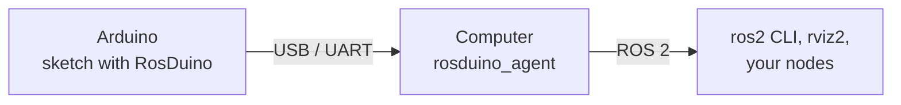

# RosDuino

[Русский](README_RU.md)

**ROS 2 for Arduino.** RosDuino turns an Arduino board into a ROS 2 node: the sketch publishes and receives topic messages and calls services. The link to the computer is `Serial`. Sketches use the simple API (`ros.begin`, `ros.subscribe`, `ros.update`).

```cpp
#include <RosDuino.h>
#include <std_msgs/msg/Bool.h>

void onLed(std_msgs::Bool msg) {
  digitalWrite(LED_BUILTIN, msg.data);
}

void setup() {
  pinMode(LED_BUILTIN, OUTPUT);
  ros.begin("led_board");
  ros.subscribe("led", onLed);
}

void loop() {
  ros.update();
}
```

```bash
ros2 topic pub --once /led std_msgs/msg/Bool "{data: true}"   # the onboard LED turns on
```

## Why

In a robot, an Arduino often owns the hardware: motors, sensors, relays, LEDs. The rest of the robot runs on a computer with ROS 2. Connecting the two usually means inventing a serial format, parsing strings on both sides, and writing a custom bridge.

RosDuino does that work. You write a sketch in the Arduino IDE and declare topics and services in it. On the computer you run one program, the `rosduino_agent` agent. The board shows up in `ros2 node list`, its topics in `ros2 topic list`, and any ROS 2 tool can use them: `ros2 topic echo`, `rviz2`, rqt, or your own Python and C++ nodes.

## What you get

- **Small boards are supported in full.** Nano and Uno, with 2 KB of RAM, are not a cut-down mode. A simple sketch is about 7 KB of flash and 550 bytes of RAM on a Nano.
- **The Arduino IDE you already use.** Install from a ZIP. Examples appear under **File → Examples**. No extra toolchain or config files.
- **The sketch tells the agent what it needs.** Topics and services are declared on the board. Change the sketch, and the agent follows on the next connection.
- **Real ROS 2 types.** `std_msgs`, `sensor_msgs`, `geometry_msgs`, and the other bundled packages use the same fields as in ROS 2. There is no intermediate string format to parse.
- **Short sketches.** One line to subscribe, one line to publish, one function for a service. Larger projects use the full API: separate `Publisher` and `Subscriber` objects and QoS.
- **Topics and services in both directions.** The board can publish, subscribe, offer a service, and call a service on the computer.
- **Bad bytes are dropped.** A damaged frame never becomes a topic message. After a board reset, an agent restart, or a replugged cable, the link comes back on its own, usually within a few seconds.
- **Logs and time.** `ros.logInfo("...")` sends a log entry to ROS 2 under the board's name. `ros.now()` returns `builtin_interfaces::msg::Time`, ROS 2 time synchronized with the computer. Link status is published on `/diagnostics`.
- **No heap.** The library does not allocate at runtime. The compiler's memory report is the memory the sketch will use.

## How it fits together



The library and the agent exchange compact frames over the serial port. The agent creates a ROS 2 node named by the sketch and forwards messages both ways. To the rest of ROS 2 the board is an ordinary node.

## Boards

The library picks buffer sizes from the board. The limits below are how many topics and services one sketch can declare in total, and how large one message may be.

| Board | Topics and services | Message size | What fits |
|---|---:|---:|---|
| Arduino Nano | up to 3 | up to 88 bytes | numbers, short strings, `Range`, `Twist`, `SetBool` |
| Arduino Uno | up to 8 | up to 152 bytes | the same, plus `PoseStamped`, `TwistStamped` |
| Arduino Micro | up to 8 | up to 152 bytes | the same as Uno. `Serial` is the USB port |
| Arduino Mega 2560 | up to 24 | up to 504 bytes | the same, plus `Imu`, `BatteryState` |
| Arduino Due | up to 64 | up to 2040 bytes | every bundled type, including `Odometry` |

The computer needs ROS 2 **Lyrical** (recommended) or **Jazzy**. On Jazzy the board cannot *offer* a service. Topics, and service calls *from* the board, still work.

## Install

### Arduino IDE

1. Download `RosDuino-x.y.z.zip` from the [releases page](https://github.com/rosduino/rosduino_arduino/releases).
2. **Sketch → Include Library → Add .ZIP Library** and select the archive.
3. Check that **File → Examples → RosDuino** is present.

If you cloned the sources, copy the library folder into your sketchbook `libraries` directory and name it `RosDuino`:

| OS | Path |
|---|---|
| Windows | `Documents\Arduino\libraries\RosDuino\` |
| macOS | `~/Documents/Arduino/libraries/RosDuino/` |
| Linux | `~/Arduino/libraries/RosDuino/` |

### arduino-cli

```bash
arduino-cli lib install --zip-path RosDuino-x.y.z.zip
```

### Agent on the computer

`rosduino_agent` is a ROS 2 package in [rosduino/rosduino_ros](https://github.com/rosduino/rosduino_ros).
On Linux with ROS 2 installed it builds like any other package:

```bash
git clone https://github.com/rosduino/rosduino_ros.git
cd rosduino_ros
colcon build
source install/setup.bash
```

On macOS and Windows, ROS 2 usually runs in Docker. See the [agent README](https://github.com/rosduino/rosduino_ros).

## Quick start

A board and a USB cable are enough. The example drives the onboard LED.

**1. Flash the board.** Open **File → Examples → RosDuino → Simple → Led**, pick the board and port under **Tools**, and click **Upload**.

> For Nano clones with the old bootloader, set the processor to **ATmega328P (Old Bootloader)**.

**2. Start the agent** on the same port the IDE used:

```bash
ros2 run rosduino_agent rosduino_agent --port /dev/ttyUSB0
```

| OS | Typical port name |
|---|---|
| Linux | `/dev/ttyUSB0` (Nano), `/dev/ttyACM0` (Uno, Micro, Mega, Due) |
| macOS | `/dev/cu.usbserial*`, `/dev/cu.wchusbserial*` (Nano), `/dev/cu.usbmodem*` (Uno, Micro, Mega, Due) |
| Windows | `COM3`, `COM4`, … |

**3. Drive the LED** from a second terminal:

```bash
ros2 topic pub --once /led std_msgs/msg/Bool "{data: true}"
ros2 topic pub --once /led std_msgs/msg/Bool "{data: false}"
```

## Examples

### Publish a sensor reading

```cpp
#include <RosDuino.h>
#include <std_msgs/msg/Int32.h>

std_msgs::Int32 light;
rosduino::Timer timer(100);   // every 100 ms

void setup() {
  ros.begin("light_sensor");
}

void loop() {
  ros.update();
  if (timer.check()) {
    light.data = analogRead(A0);
    ros.publish("light", light);
  }
}
```

```bash
ros2 topic echo /light
```

### A service on the board

```cpp
#include <RosDuino.h>
#include <std_srvs/srv/SetBool.h>

void onSetLed(std_srvs::SetBool& srv) {
  digitalWrite(LED_BUILTIN, srv.request.data);
  srv.response.success = true;
  srv.response.message = "done";
}

void setup() {
  pinMode(LED_BUILTIN, OUTPUT);
  ros.begin("led_service");
  ros.service("set_led", onSetLed);
}

void loop() {
  ros.update();
}
```

```bash
ros2 service call /set_led std_srvs/srv/SetBool "{data: true}"
```

### Port and baud

By default the library uses `Serial` at 115200. On Leonardo and Micro, `Serial` is the USB port, and `ros.begin("name")` opens it. Pass another port or baud to `ros.begin()`. The sketch does not call `begin()` on that port itself:

```cpp
ros.begin("led_board");                   // Serial, 115200
ros.begin(Serial1, "led_board");          // Serial1, 115200
ros.begin(Serial1, 57600, "led_board");   // Serial1, 57600
```

On Micro, Mega, and Due the agent can sit on `Serial1` (through a USB-UART adapter). `Serial` and the Serial Monitor stay free for debugging. See `Simple/LedSerial1`. On Micro those pins are 0 and 1; on Mega and Due they are 18 and 19. The baud must match the agent's `--baud`. The full API is the same call with the name in flash: `node.begin(Serial1, F("led_board"))`.

### Sketches in the library

| Sketch | What it shows |
|---|---|
| `Simple/Led` | subscribe: the LED follows a ROS 2 command |
| `Simple/LightSensor` | publish a sensor reading |
| `Simple/LedService` | a service on the board |
| `Simple/AddServer`, `Simple/AddClient` | an add service on the board, and a call from the board |
| `Simple/LedSerial1` | the agent on `Serial1`, `Serial` free for debug (Micro, Mega, Due) |
| `Full/Blink`, `Full/PubSub` | the full API: separate publisher and subscriber objects |
| `Full/ServiceServer`, `Full/ServiceClient` | services in the full API |
| `Full/TimeAndLog` | ROS 2 time and logs |
| `Full/NanoBasic` | a small Nano robot: range, battery voltage, LED |

Each sketch is described in [`docs/examples.md`](docs/examples.md).

## Message types

The library ships headers for `std_msgs`, `std_srvs`, `example_interfaces`, `builtin_interfaces`, common `geometry_msgs` types (`Twist`, `Pose`, `Point`, …), `sensor_msgs` (`Range`, `Imu`, `Temperature`, `BatteryState`, `Joy`), and `nav_msgs/Odometry`.

Include a type the same way ROS 2 does:

```cpp
#include <sensor_msgs/msg/Range.h>

sensor_msgs::Range range;   // or the full name sensor_msgs::msg::Range
```

`rosduino-gen`, in the [agent repository](https://github.com/rosduino/rosduino_ros), writes headers for your own `.msg` and `.srv` files.

## Tips

- **The library owns `Serial`.** Do not call `Serial.print`, and close the Serial Monitor. The agent needs the port.
  For debug text use `ros.logDebug(...)`, `ros.logInfo(...)`, `ros.logWarn(...)`, `ros.logError(...)`, and `ros.logFatal(...)`.
  On Micro, Mega, and Due you can move the agent to `Serial1` and leave `Serial` free (see "Port and baud").
- **Call `ros.update()` on every `loop()`.** Avoid long `delay()` calls. Use `rosduino::Timer` for periodic work.
- **Stop the agent before uploading**, or the port stays busy.
- **`ros.connected()`** is true when the agent is connected. Until then `ros.publish` returns `rosduino::Result::NotConnected` and sends nothing.
- **Arduino Due** uses the Programming Port by default. For Native USB, add `#define ROSDUINO_SERIALUSB` before `#include <RosDuino.h>`, or call `ros.begin(SerialUSB, "name")`.

### Settings

Set these with `#define` before `#include <RosDuino.h>`. The defaults are usually enough.

| Setting | Effect |
|---|---|
| `ROSDUINO_DEFAULT_BAUD` | baud used when `ros.begin()` does not pass one (default 115200) |
| `ROSDUINO_MAX_ENTITIES` | how many topics and services can be declared |
| `ROSDUINO_RX_SIZE`, `ROSDUINO_TX_SIZE` | maximum incoming and outgoing frame size |
| `ROSDUINO_SERIALUSB` | open `SerialUSB` (Due Native USB) from `begin(name)` |
| `ROSDUINO_NO_LOG`, `ROSDUINO_NO_TIME` | drop logs or time sync to save memory |
| `ROSDUINO_NO_GLOBAL` | omit the global `ros` object when the sketch uses only the full API |

## Other projects

| Project | Difference |
|---|---|
| [micro-ROS](https://micro.ros.org/) | more capable, but needs boards with more memory; Nano, Uno, and Mega are not supported |
| [ros2arduino](https://github.com/ROBOTIS-GIT/ros2arduino) | 32-bit boards only, and the project is no longer developed |
| [rosserial](http://wiki.ros.org/rosserial) | ROS 1 only |
| [mROS 2](https://github.com/mROS-base/mros2), [nano-ros](https://github.com/NEWSLabNTU/nano-ros) | other platforms and toolchains, not the Arduino IDE |

RosDuino is for ROS 2 on the classic Arduino boards, written in the Arduino IDE.

## Documentation

- [rosduino/rosduino_ros](https://github.com/rosduino/rosduino_ros) — the `rosduino_agent` agent and the `rosduino-gen` message generator.
- [`docs/examples.md`](docs/examples.md) — every example ([Russian](docs/examples_RU.md)).
- [`docs/protocol.md`](docs/protocol.md) — the wire protocol, for a separate implementation.

## License

[Apache-2.0](LICENSE).
