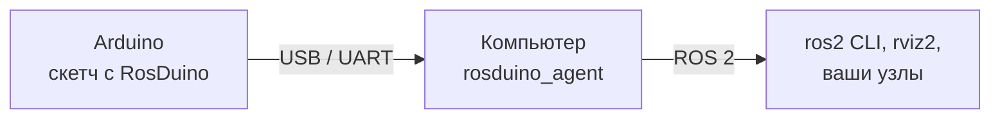

# RosDuino

[English](README.md)

**ROS 2 для Arduino.** RosDuino превращает плату Arduino в узел ROS 2: скетч публикует и получает сообщения топиков и вызывает сервисы. Связь с компьютером идёт через `Serial`. Скетч пишется на простом API (`ros.begin`, `ros.subscribe`, `ros.update`).

```cpp
#include <RosDuino.h>
#include <std_msgs/msg/Bool.h>

void onLed(std_msgs::Bool msg) {
  digitalWrite(LED_BUILTIN, msg.data);
}

void setup() {
  pinMode(LED_BUILTIN, OUTPUT);
  ros.begin("led_board");
  ros.subscribe("led", onLed);
}

void loop() {
  ros.update();
}
```

```bash
ros2 topic pub --once /led std_msgs/msg/Bool "{data: true}"   # светодиод на плате загорелся
```

## Зачем это нужно

В робототехнике Arduino часто отвечает за «железо»: моторы, датчики, реле, светодиоды. А мозг робота работает
на компьютере под ROS 2. Связать их обычно непросто: приходится придумывать свой формат обмена по serial,
писать разбор строк на обеих сторонах и отдельную программу-переходник на компьютере.

RosDuino снимает эту работу. Вы пишете скетч в Arduino IDE так же, как обычно, и объявляете в нём топики
и сервисы. На компьютере запускается одна готовая программа — агент `rosduino_agent`. Плата появляется
в `ros2 node list`, её топики — в `ros2 topic list`, и с ними можно работать любыми средствами ROS 2:
`ros2 topic echo`, `rviz2`, rqt, ваши собственные узлы на Python и C++.

## Преимущества

- **Работает на самых маленьких платах.** Nano и Uno с их 2 КБ памяти поддерживаются полностью, а не «в урезанном
  режиме». Простой скетч занимает около 7 КБ флеша и 550 байт памяти на Nano.
- **Привычная Arduino IDE.** Установка из ZIP, примеры в меню **Файл → Примеры**, никаких отдельных систем сборки,
  тулчейнов и конфигурационных файлов.
- **Ничего не нужно настраивать на компьютере.** Скетч сам сообщает агенту, какие топики и сервисы ему нужны.
  Поменяли скетч — агент подстроится при следующем подключении.
- **Настоящие типы ROS 2.** `std_msgs`, `sensor_msgs`, `geometry_msgs` и другие пакеты: на плате те же сообщения
  с теми же полями, что и в ROS 2. Никаких промежуточных форматов и ручного разбора строк.
- **Короткий и понятный код.** Подписка на топик — одна строка, публикация — одна строка, сервис — одна функция.
  Для сложных проектов есть расширенный вариант с отдельными объектами и настройками качества доставки (QoS).
- **Топики и сервисы в обе стороны.** Плата может и публиковать, и подписываться, и предоставлять сервисы,
  и сама вызывать сервисы на компьютере.
- **Надёжная связь.** Повреждённые по пути данные отбрасываются, а не превращаются в мусор в топиках.
  После перезагрузки платы, перезапуска агента или переподключения кабеля связь восстанавливается сама,
  обычно за пару секунд.
- **Логи и время.** `ros.logInfo("...")` отправляет запись в журнал ROS 2 от имени платы. `ros.now()` возвращает
  `builtin_interfaces::msg::Time` — время ROS 2, синхронизированное с компьютером. Состояние связи публикуется
  в `/diagnostics`.
- **Предсказуемое поведение.** Библиотека не выделяет память динамически: всё, что ей нужно, видно в отчёте
  компилятора о занятой памяти ещё до загрузки на плату.

## Как это устроено



Библиотека на плате и агент на компьютере обмениваются компактными пакетами по serial-порту. Агент создаёт
в ROS 2 узел с именем платы и пересылает сообщения в обе стороны. Для остального ROS 2 плата выглядит как обычный
узел.

## Поддерживаемые платы

Библиотека сама подбирает размеры буферов под плату. Ограничения ниже — это сколько топиков и сервисов
(в сумме) может объявить один скетч и насколько большие сообщения он передаёт.

| Плата | Топиков и сервисов | Размер сообщения | Что помещается |
|---|---:|---:|---|
| Arduino Nano | до 3 | до 88 байт | числа, короткие строки, `Range`, `Twist`, `SetBool` |
| Arduino Uno | до 8 | до 152 байт | то же, плюс `PoseStamped`, `TwistStamped` |
| Arduino Micro | до 8 | до 152 байт | то же, что на Uno. `Serial` — это USB |
| Arduino Mega 2560 | до 24 | до 504 байт | то же, плюс `Imu`, `BatteryState` |
| Arduino Due | до 64 | до 2040 байт | всё из комплекта, включая `Odometry` |

На компьютере нужен ROS 2 **Lyrical** (рекомендуется) или **Jazzy**. В Jazzy есть одно ограничение:
плата не может *предоставлять* сервис; топики и вызов сервисов *с* платы работают.

## Установка

### Arduino IDE

1. Скачайте архив `RosDuino-x.y.z.zip` со [страницы релизов](https://github.com/rosduino/rosduino_arduino/releases).
2. **Скетч → Подключить библиотеку → Добавить .ZIP-библиотеку** и выберите архив.
3. Проверьте, что появились **Файл → Примеры → RosDuino**.

Если вы скачали исходники (git clone), скопируйте папку библиотеки в каталог `libraries` вашего скетчбука под
именем `RosDuino`:

| ОС | Путь |
|---|---|
| Windows | `Документы\Arduino\libraries\RosDuino\` |
| macOS | `~/Documents/Arduino/libraries/RosDuino/` |
| Linux | `~/Arduino/libraries/RosDuino/` |

### arduino-cli

```bash
arduino-cli lib install --zip-path RosDuino-x.y.z.zip
```

### Агент на компьютере

Агент `rosduino_agent` — это пакет ROS 2 из репозитория [rosduino/rosduino_ros](https://github.com/rosduino/rosduino_ros).
На Linux с установленным ROS 2 он собирается как любой другой пакет:

```bash
git clone https://github.com/rosduino/rosduino_ros.git
cd rosduino_ros
colcon build
source install/setup.bash
```

На macOS и Windows ROS 2 обычно запускают в Docker; подробности — в [README агента](https://github.com/rosduino/rosduino_ros).

## Быстрый старт

Нужны только плата и USB-кабель: пример управляет встроенным светодиодом.

**1. Прошейте плату.** Откройте **Файл → Примеры → RosDuino → Simple → Led**, выберите плату и порт в меню
**Инструменты** и нажмите **Загрузка**.

> Для клонов Nano со старым загрузчиком выберите процессор **ATmega328P (Old Bootloader)**.

**2. Запустите агент** и укажите порт платы — тот же, что в Arduino IDE:

```bash
ros2 run rosduino_agent rosduino_agent --port /dev/ttyUSB0
```

| ОС | Как обычно называется порт |
|---|---|
| Linux | `/dev/ttyUSB0` (Nano), `/dev/ttyACM0` (Uno, Micro, Mega, Due) |
| macOS | `/dev/cu.usbserial*`, `/dev/cu.wchusbserial*` (Nano), `/dev/cu.usbmodem*` (Uno, Micro, Mega, Due) |
| Windows | `COM3`, `COM4`, … |

**3. Управляйте светодиодом** из второго терминала:

```bash
ros2 topic pub --once /led std_msgs/msg/Bool "{data: true}"
ros2 topic pub --once /led std_msgs/msg/Bool "{data: false}"
```

## Примеры

### Публикация данных датчика

```cpp
#include <RosDuino.h>
#include <std_msgs/msg/Int32.h>

std_msgs::Int32 light;
rosduino::Timer timer(100);   // каждые 100 мс

void setup() {
  ros.begin("light_sensor");
}

void loop() {
  ros.update();
  if (timer.check()) {
    light.data = analogRead(A0);
    ros.publish("light", light);
  }
}
```

```bash
ros2 topic echo /light
```

### Сервис на плате

```cpp
#include <RosDuino.h>
#include <std_srvs/srv/SetBool.h>

void onSetLed(std_srvs::SetBool& srv) {
  digitalWrite(LED_BUILTIN, srv.request.data);
  srv.response.success = true;
  srv.response.message = "done";
}

void setup() {
  pinMode(LED_BUILTIN, OUTPUT);
  ros.begin("led_service");
  ros.service("set_led", onSetLed);
}

void loop() {
  ros.update();
}
```

```bash
ros2 service call /set_led std_srvs/srv/SetBool "{data: true}"
```

### Выбор порта и скорости

По умолчанию библиотека работает через `Serial` на скорости 115200. На Leonardo и Micro `Serial` — это
USB-порт, и `ros.begin("имя")` открывает его. Другой порт и скорость указывают в `ros.begin()`, порт
открывать самому не нужно:

```cpp
ros.begin("led_board");                   // Serial, 115200
ros.begin(Serial1, "led_board");          // Serial1, 115200
ros.begin(Serial1, 57600, "led_board");   // Serial1, 57600
```

На Micro, Mega и Due агент можно подключить к `Serial1` (через USB-UART адаптер), тогда обычный `Serial`
и Serial Monitor остаются свободны для отладки — см. пример `Simple/LedSerial1`. На Micro это пины 0/1,
на Mega и Due — 18/19. Скорость должна совпадать
с параметром `--baud` агента. В расширенном варианте API то же самое: `node.begin(Serial1, F("led_board"))`.

### Все примеры в комплекте

| Пример | Что показывает |
|---|---|
| `Simple/Led` | подписка: светодиод по команде из ROS 2 |
| `Simple/LightSensor` | публикация показаний датчика |
| `Simple/LedService` | сервис на плате |
| `Simple/AddServer`, `Simple/AddClient` | сервис сложения: на плате и вызов с платы |
| `Simple/LedSerial1` | агент на `Serial1`, `Serial` свободен для отладки (Micro, Mega, Due) |
| `Full/Blink`, `Full/PubSub` | расширенный вариант API: отдельные объекты издателя и подписчика |
| `Full/ServiceServer`, `Full/ServiceClient` | сервисы в расширенном варианте API |
| `Full/TimeAndLog` | время ROS 2 и вывод в журнал |
| `Full/NanoBasic` | небольшой робот на Nano: дальномер, напряжение батареи, светодиод |

Подробное описание каждого примера — в [`docs/examples_RU.md`](docs/examples_RU.md).

## Типы сообщений

В библиотеку входят готовые заголовки для популярных пакетов: `std_msgs`, `std_srvs`, `example_interfaces`,
`builtin_interfaces`, а также часто используемые типы из `geometry_msgs` (`Twist`, `Pose`, `Point`, …),
`sensor_msgs` (`Range`, `Imu`, `Temperature`, `BatteryState`, `Joy`) и `nav_msgs/Odometry`.

Подключается нужный тип так же, как в ROS 2:

```cpp
#include <sensor_msgs/msg/Range.h>

sensor_msgs::Range range;   // или полное имя sensor_msgs::msg::Range
```

Для своих `.msg` и `.srv` заголовки создаёт генератор `rosduino-gen` из [репозитория агента](https://github.com/rosduino/rosduino_ros).

## Советы

- **Serial занят библиотекой.** Не используйте `Serial.print` и закройте Serial Monitor — порт нужен агенту.
  Для отладочных сообщений есть `ros.logDebug(...)`, `ros.logInfo(...)`, `ros.logWarn(...)`, `ros.logError(...)` и `ros.logFatal(...)`.
  На Micro, Mega и Due можно перенести агента на `Serial1` и освободить `Serial` (см. «Выбор порта и скорости»).
- **Вызывайте `ros.update()` в каждом `loop()`.** Избегайте длинных `delay()`; для периодических действий
  есть `rosduino::Timer`.
- **Перед прошивкой остановите агент**, иначе порт будет занят.
- **`ros.connected()`** показывает, подключён ли агент. Пока его нет, `ros.publish` возвращает `rosduino::Result::NotConnected` и ничего не отправляет.
- **Arduino Due** по умолчанию работает через Programming Port. Чтобы использовать Native USB, добавьте
  `#define ROSDUINO_SERIALUSB` перед `#include <RosDuino.h>` или вызовите `ros.begin(SerialUSB, "имя")`.

### Настройки

Их задают через `#define` перед `#include <RosDuino.h>`. Обычно менять ничего не нужно.

| Настройка | Что делает |
|---|---|
| `ROSDUINO_DEFAULT_BAUD` | скорость порта, если она не указана в `ros.begin()` (по умолчанию 115200) |
| `ROSDUINO_MAX_ENTITIES` | сколько топиков и сервисов можно объявить |
| `ROSDUINO_RX_SIZE`, `ROSDUINO_TX_SIZE` | максимальный размер входящего и исходящего сообщения |
| `ROSDUINO_SERIALUSB` | использовать Native USB на Due |
| `ROSDUINO_NO_LOG`, `ROSDUINO_NO_TIME` | отключить логи или время, чтобы сэкономить память |
| `ROSDUINO_NO_GLOBAL` | отключить глобальный объект `ros`, если используется только расширенный API |

## Сравнение с другими проектами

| Проект | Чем отличается |
|---|---|
| [micro-ROS](https://micro.ros.org/) | мощнее, но требует плат с большим объёмом памяти; Nano, Uno и Mega не поддерживает |
| [ros2arduino](https://github.com/ROBOTIS-GIT/ros2arduino) | только 32-битные платы, проект не развивается |
| [rosserial](http://wiki.ros.org/rosserial) | только для ROS 1 |
| [mROS 2](https://github.com/mROS-base/mros2), [nano-ros](https://github.com/NEWSLabNTU/nano-ros) | другие платформы и среды разработки, без Arduino IDE |

RosDuino занимает нишу, которую эти проекты оставляют пустой: ROS 2 на классических Arduino прямо из Arduino IDE.

## Документация

- [rosduino/rosduino_ros](https://github.com/rosduino/rosduino_ros) — агент `rosduino_agent` и генератор сообщений `rosduino-gen`.
- [`docs/examples_RU.md`](docs/examples_RU.md) — разбор всех примеров ([English](docs/examples.md)).
- [`docs/protocol.md`](docs/protocol.md) — протокол обмена, на английском, для тех, кто хочет написать свою реализацию.

## Лицензия

[Apache-2.0](LICENSE).
