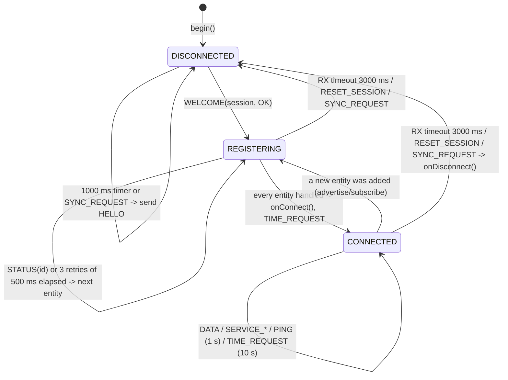
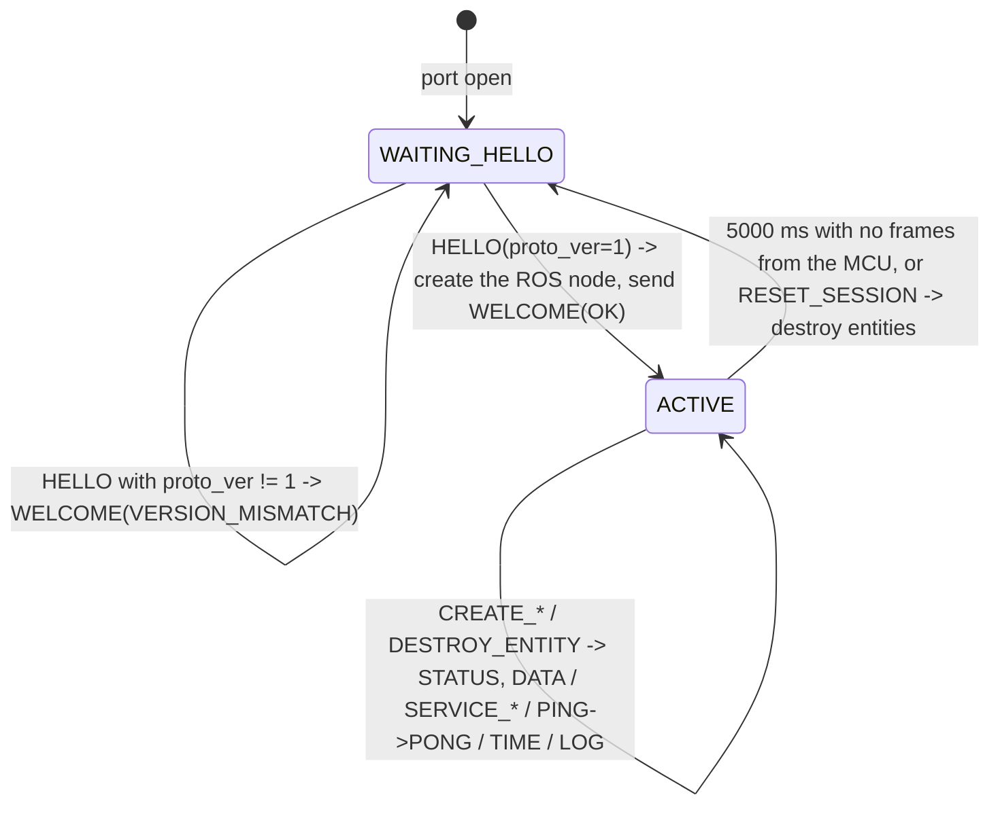

# RosDuino serial protocol

**Status: normative specification v1 (`proto_ver = 1`).**
The only implementation is `src/rosduino/core/`.

---

## 1. Layers

1. **Transport** — a byte stream: UART / USB-CDC on the MCU; a serial port or TCP on the agent.
   The protocol does not depend on the transport.
2. **Frame** — COBS + delimiter `0x00` + CRC-16/CCITT-FALSE.
3. **Command** — type (`type:u8`), sequence number (`seq:u8`), body (`body[...]`).
4. **Payload** — a CDR-serialized ROS 2 message (XCDR1 little-endian, without the encapsulation header).

---

## 2. Frame

```text
decoded frame (raw frame):  type:u8 | seq:u8 | body[...] | crc16:u16 LE
on the wire (wire frame):   COBS( raw frame ) | 0x00
```

- **Minimum decoded frame:** 4 bytes (`type:u8`, `seq:u8`, `crc16:u16 LE`, empty `body`). A frame shorter than 4 bytes after COBS decoding is dropped with `TOO_SHORT`.
- **Empty delimiter (consecutive `0x00`):** an empty COBS block between two `0x00` bytes (length 0) is ignored and does not increment the error counter. A frame may therefore start with `0x00`, which forces any garbage on the line to be discarded.
- **COBS (Consistent Overhead Byte Stuffing):**
  - A block of up to 254 non-zero bytes is prefixed by a code byte `code = N + 1` (`0x01..0xFE`).
  - If `code < 0xFF`, the code also encodes an implicit `0x00` after the `N` data bytes, except at the end of the frame, immediately before the `0x00` delimiter.
  - If a block contains exactly 254 non-zero bytes (`code == 0xFF`), no implicit `0x00` follows it. The code byte of the next block comes next.
  - If the `0x00` delimiter arrives before `code - 1` bytes have been read, the frame is dropped with `COBS_ERROR`.
- **CRC-16/CCITT-FALSE:**
  - Polynomial `0x1021`, initial value `0xFFFF`, `refIn = false`, `refOut = false`, `xorOut = 0x0000`.
  - Computed over `type | seq | body[...]` and written at the end of the decoded frame in **little-endian** (`crc_lo = crc & 0xFF`, `crc_hi = (crc >> 8) & 0xFF`).
  - On a CRC mismatch the frame is dropped silently and `crc_errors` is incremented (`CRC_MISMATCH`).
- **Frame size limits (`rx_max` / `tx_max`):**
  - `rx_max` and `tx_max` are the maximum size of a **decoded** frame in bytes, including the 4 overhead bytes `type`, `seq`, and `crc16`.
  - A sender must not exceed `min(local tx_max, remote rx_max)`.
  - If the decoded size exceeds the local `rx_max`, the receiver discards the current buffer, waits for the next `0x00` delimiter, and increments `rx_overflow` (`FRAME_TOO_LARGE`).
- **Byte order:** every multi-byte header field is **little-endian**.
- **Strings (`str`) in control commands:** `len:u8` followed by `len` bytes of ASCII/UTF-8, with **no** trailing `\0`.
- **Sequence number (`seq:u8`):**
  - Each side has its own 8-bit counter of outgoing frames, `0..255`, wrapping with unsigned overflow (`255 + 1 -> 0`).
  - In reply frames:
    - In `WELCOME`, the header `seq` equals the `seq` of the received `HELLO`.
    - In `PONG`, the header `seq` equals the `seq` of the received `PING`.
    - In `TIME`, the header `seq` equals the `seq` of the received `TIME_REQUEST`.
    - In `STATUS`, the header `seq` comes from the agent's own counter, and the request `seq` is carried in the body field `ref_seq:u8`.

---

## 3. Commands and header fields

MCU→A is microcontroller to agent. A→MCU is agent to microcontroller.

| Code | Name | Direction | Body (`body`) |
|---|---|---|---|
| `0x01` | `HELLO` | MCU→A | `proto_ver:u8, session:u16, rx_max:u16, tx_max:u16, max_entities:u8, flags:u8, node_name:str, namespace:str` |
| `0x02` | `WELCOME` | A→MCU | `proto_ver:u8, session:u16, rx_max:u16, status:u8` |
| `0x03` | `PING` | both | *(empty, 0 B)* |
| `0x04` | `PONG` | both | *(empty, 0 B)* |
| `0x05` | `SYNC_REQUEST` | A→MCU | *(empty, 0 B)* (asks for `HELLO`: the MCU is already running and the agent has just started) |
| `0x06` | `RESET_SESSION` | both | `reason:u8` |
| `0x10` | `CREATE_PUBLISHER` | MCU→A | `id:u8, qos:u8, depth:u8, name:str, type:str, hash:u64` |
| `0x11` | `CREATE_SUBSCRIBER` | MCU→A | `id:u8, qos:u8, depth:u8, name:str, type:str, hash:u64` |
| `0x12` | `CREATE_SERVICE_SERVER` | MCU→A | `id:u8, name:str, type:str, hash:u64` |
| `0x13` | `CREATE_SERVICE_CLIENT` | MCU→A | `id:u8, name:str, type:str, hash:u64` |
| `0x1F` | `DESTROY_ENTITY` | MCU→A | `id:u8` |
| `0x20` | `STATUS` | A→MCU | `ref_seq:u8, id:u8, code:u8` |
| `0x30` | `DATA` | both | `id:u8, cdr[...]` (MCU→A for a publisher, A→MCU for a subscriber) |
| `0x31` | `SERVICE_REQUEST` | both | `id:u8, req_id:u8, cdr[...]` (A→MCU for a server, MCU→A for a client) |
| `0x32` | `SERVICE_RESPONSE` | both | `id:u8, req_id:u8, cdr[...]` (MCU→A for a server, A→MCU for a client) |
| `0x40` | `TIME_REQUEST` | MCU→A | *(empty, 0 B)* |
| `0x41` | `TIME` | A→MCU | `sec:i32, nanosec:u32` (the agent's ROS time) |
| `0x42` | `LOG` | MCU→A | `level:u8, text:str` |

Codes `0x50..0x7F` are reserved for future extensions. A frame with an unknown `type` is dropped with `UNKNOWN_COMMAND`.

### 3.1. `flags:u8` in `HELLO`

| Bits | Mask | Meaning | Values |
|---|---|---|---|
| `0..2` | `0x07` | MCU resource-profile code | `0` = Default, `1` = Lite, `2` = Small, `3` = Medium, `4` = Large |
| `3` | `0x08` | `ROSDUINO_NO_TIME` | `1` — time sync is disabled on the MCU |
| `4` | `0x10` | `ROSDUINO_NO_LOG` | `1` — log sending is disabled on the MCU |
| `5` | `0x20` | `AVR_FLOAT64` | `1` — `double` is 32 bits on the MCU (`float` ↔ IEEE-754 `float64` conversion) |
| `6..7` | `0xC0` | Reserved | Must be `0` (ignored by the receiver) |

### 3.2. `status:u8` codes (in `WELCOME` and `STATUS`)

| Code | Name | Description |
|---:|---|---|
| `0` | `OK` | Success |
| `1` | `UNKNOWN_TYPE` | The message or service type was not found in the ROS 2 environment |
| `2` | `HASH_MISMATCH` | The first 8 bytes of the type's RIHS01 hash do not match the type in the agent's environment |
| `3` | `BAD_NAME` | Invalid node name, namespace, topic name, or service name |
| `4` | `ROS_ERROR` | `rclcpp` / RMW failed while creating the node or the entity |
| `5` | `NO_RESOURCES` | The entity limit (`id >= max_entities`) or another resource limit was exceeded |
| `6` | `UNKNOWN_ENTITY` | No entity with this `id` is registered |
| `7` | `TOO_LARGE` | The message or request exceeds the allowed buffer size |
| `8` | `VERSION_MISMATCH` | Unsupported protocol version `proto_ver` (current: `1`) |
| `9` | `NOT_IN_SESSION` | The command arrived before the `HELLO` / `WELCOME` handshake finished |
| `10` | `UNSUPPORTED` | The feature is not supported by this ROS 2 distribution (for example `CREATE_SERVICE_SERVER` on Jazzy) |

### 3.3. `reason:u8` codes in `RESET_SESSION`

| Code | Name | Description |
|---:|---|---|
| `0` | `UNSPECIFIED` | Generic session reset |
| `1` | `AGENT_SHUTDOWN` | The agent is shutting down normally (for example on `SIGINT` / Ctrl+C) |
| `2` | `MCU_REBOOT` | The MCU is restarting the connection (a second `begin()`) |
| `3` | `PROTOCOL_ERROR` | A fatal protocol violation |
| `4` | `TIMEOUT` | The session activity timeout expired |

### 3.4. `qos:u8` and `depth:u8` in `CREATE_PUBLISHER` / `CREATE_SUBSCRIBER`

- `qos:u8`:
  - bit `0` (`0x01`): `1` = `RELIABLE`, `0` = `BEST_EFFORT`.
  - bit `1` (`0x02`): `1` = `TRANSIENT_LOCAL`, `0` = `VOLATILE`.
  - bits `2..7` (`0xFC`): reserved (`0`).
- Presets:
  - `QoS::defaults()` → `qos = 0x01` (`RELIABLE | VOLATILE`), `depth = 10`.
  - `QoS::sensorData()` → `qos = 0x00` (`BEST_EFFORT | VOLATILE`), `depth = 5`.
- `depth:u8`: the `KEEP_LAST` depth (`depth == 0` is treated as `1` by the agent).

### 3.5. `level:u8` in `LOG`

The values match `RCUTILS_LOG_SEVERITY`:
- `10` = `DEBUG`
- `20` = `INFO`
- `30` = `WARN`
- `40` = `ERROR`
- `50` = `FATAL`

### 3.6. A repeated `CREATE_*` and `DESTROY_ENTITY`

- **A repeated `CREATE_*` with the same `id` in the same `session`:**
  - If `id >= max_entities` (from `HELLO`), the agent replies `STATUS(ref_seq, id, NO_RESOURCES)`.
  - If an entity with this `id` already exists with the **same** kind (`PUBLISHER` / `SUBSCRIBER` / `SERVICE_SERVER` / `SERVICE_CLIENT`), `name`, `type`, `hash` (and `qos` / `depth` for topics), the request is an idempotent repeat (for example the previous `STATUS` was lost). The agent does **not** recreate the entity in ROS 2 and replies `STATUS(ref_seq, id, OK)` immediately.
  - If the parameters differ, the agent destroys the previous entity with this `id`, creates a new one, and returns its `STATUS`.
- **`DESTROY_ENTITY(id)`:**
  - If an entity with this `id` exists, the agent removes it from ROS 2 and replies `STATUS(ref_seq, id, OK)`.
  - If no entity with this `id` is registered, the agent replies `STATUS(ref_seq, id, UNKNOWN_ENTITY)` and does not drop the session.

---

## 4. Payload (CDR)

- The MCU serializes messages as **CDR little-endian (XCDR1)**, the format ROS 2 uses on the wire,
  **without** the 4-byte encapsulation header. The agent prepends `00 01 00 00` when publishing into ROS and strips the first 4 bytes
  when forwarding to the MCU, after checking that `buffer_length >= 4` and `(buffer[1] & 0x01) == 0x01` (little-endian).
- CDR field alignment (`1, 2, 4, 8` bytes, including `int64` / `uint64` / `float64`) is counted from the **start of the CDR payload**
  (immediately after `id:u8` in `DATA`, or after `id:u8, req_id:u8` in `SERVICE_REQUEST` / `SERVICE_RESPONSE`), not from the start of the frame or the buffer address.
  Deserialization on the MCU is byte-wise (`memcpy`), with no unaligned access (required on the Cortex-M3 in Due).
- Empty structs (`std_msgs/msg/Empty`, `std_srvs/srv/Empty_Request`, and the like) are encoded in ROS 2 CDR as a single byte `0x00`
  (`structure_needs_at_least_one_member`).
- On transmit (`Writer`), alignment bytes between fields are filled with `0x00`. No trailing padding is added after the last field.
  On receive (`Reader`), alignment bytes between fields are not checked, and extra trailing bytes (`0..3` alignment bytes
  that `rmw_fastrtps_cpp` may append) after the last field are ignored. This keeps the parser independent of the RMW
  (`rmw_fastrtps_cpp`, `rmw_cyclonedds_cpp`, `rmw_zenoh_cpp`).
- For topics the agent does not parse the bytes (`GenericPublisher` / `GenericSubscription`).
  For services it converts CDR to and from an in-memory message through `TypeRegistry`.

---

## 5. State machines

### 5.1. Microcontroller session state machine

MCU states:
1. **`DISCONNECTED`** — the state after `begin()`, after the link is lost (3 s with no frames from the agent), or after `RESET_SESSION`.
   - Sends `HELLO` on entry (or when `SYNC_REQUEST` arrives), then every `1000 ms`, until a valid `WELCOME(proto_ver=1, session=S, status=OK)` arrives.
2. **`REGISTERING`** — the session is up (`WELCOME` received). The MCU registers entities from its table in order (`0 .. count-1`).
   - Sends `CREATE_*` for the first unconfirmed entity and waits for `STATUS(ref_seq, id, code)` with a timeout of `500 ms` (up to 3 retries, 4 attempts in total).
   - If `STATUS` arrives with `code == OK`, the entity becomes `ACTIVE` and the MCU moves to the next entity.
   - If `STATUS` arrives with `code != OK`, or the 3 retries expire, the entity is marked with the error code (`entity.status()`) and the MCU moves to the next entity.
   - When every registered entity has been handled, the MCU enters `CONNECTED` (and, unless `NO_TIME` is set, sends the first `TIME_REQUEST`).
3. **`CONNECTED`** — the working state (`node.connected() == true` when no entity is waiting to be registered).
   - `DATA`, `SERVICE_REQUEST`, `SERVICE_RESPONSE`, `TIME_REQUEST` / `TIME`, and `LOG` may be sent and received.
   - If the application adds an entity at runtime (for example the first `ros.publish()` in the simple API), the MCU returns to `REGISTERING` to register it.
   - If the MCU has sent nothing for `1000 ms`, it sends `PING`.
   - Every `10 000 ms` (unless `ROSDUINO_NO_TIME` is set) it sends `TIME_REQUEST`.
   - If no valid frame arrives from the agent for `3000 ms`, or `RESET_SESSION` arrives, or `WELCOME` arrives with an error, every entity is put back to waiting for registration, `onDisconnect` is called, and the MCU enters `DISCONNECTED`.
   - If `SYNC_REQUEST` arrives in `REGISTERING` or `CONNECTED` (the agent restarted), the MCU clears entity confirmation immediately, enters `DISCONNECTED`, and sends `HELLO` out of turn.



| MCU state | Event | Action | Next state |
|---|---|---|---|
| `DISCONNECTED` | Entry / `1000 ms` timer / `SYNC_REQUEST` received | Send `HELLO(proto_ver=1, session, ...)` | `DISCONNECTED` |
| `DISCONNECTED` | `WELCOME(proto_ver=1, session, status=OK)` received | Store `agent_rx_max`, reset the registration index to `0` | `REGISTERING` |
| `DISCONNECTED` | `WELCOME` with `status != OK` received | Record the error, wait for the `1000 ms` timer | `DISCONNECTED` |
| `REGISTERING` | Entity `i` is still unhandled | Send `CREATE_*(id=i)`, start the `500 ms` timer (`retries=0`) | `REGISTERING` |
| `REGISTERING` | `STATUS(ref_seq, id=i, code)` received | Store `code` on entity `i` (`OK` means active, otherwise an error), advance to `i+1` | `REGISTERING` / `CONNECTED` |
| `REGISTERING` | `500 ms` timer expired (`retries < 3`) | `retries++`, repeat `CREATE_*(id=i)` | `REGISTERING` |
| `REGISTERING` | `500 ms` timer expired (`retries == 3`) | Mark entity `i` with `Timeout`, advance to `i+1` | `REGISTERING` / `CONNECTED` |
| `REGISTERING` | Every entity has been handled | Call `onConnect()`, send `TIME_REQUEST` (if `!NO_TIME`) | `CONNECTED` |
| `CONNECTED` | No outgoing frame for `1000 ms` | Send `PING` | `CONNECTED` |
| `CONNECTED` | `10 000 ms` timer (if `!NO_TIME`) | Send `TIME_REQUEST` | `CONNECTED` |
| `REGISTERING` / `CONNECTED` | `PING` received | Send `PONG(seq = ping.seq)` | unchanged |
| `REGISTERING` / `CONNECTED` | `SYNC_REQUEST` received | Clear entity confirmations, send `HELLO` | `DISCONNECTED` |
| `REGISTERING` / `CONNECTED` | `RESET_SESSION` received, or `3000 ms` with no incoming frame | Clear entity confirmations, call `onDisconnect()` | `DISCONNECTED` |

### 5.2. Agent session state machine

Agent states:
1. **`WAITING_HELLO`** — the state after the port or TCP connection is opened, after `RESET_SESSION`, or after `5000 ms` with no frames from the MCU (unless `--keep-on-disconnect` is set).
   - Sends `SYNC_REQUEST` every `500 ms` until `HELLO` arrives.
   - Replies `STATUS(ref_seq, id, NOT_IN_SESSION)` to any `CREATE_*`, `DATA`, or `SERVICE_*` that arrives before `HELLO`.
2. **`ACTIVE`** — the session is up.
   - On `HELLO`:
     - If `proto_ver != 1`: reply `WELCOME(proto_ver=1, session, rx_max, VERSION_MISMATCH)` and stay in `WAITING_HELLO`.
     - If `node_name` or `namespace` is invalid: reply `WELCOME(..., BAD_NAME)` and stay in `WAITING_HELLO`.
     - If `HELLO.session != current_session` (the MCU rebooted, or this is the first entry): destroy every entity and the node of the old session, create a new ROS node `node_name` (on a name clash in the ROS graph, append `_2`, `_3`, …), store the MCU parameters, and reply `WELCOME(1, session, agent_rx_max, OK)`.
     - If `HELLO.session == current_session` (a repeated `HELLO`, or resynchronization): reuse the existing ROS node and reply `WELCOME(1, session, agent_rx_max, OK)`.
   - Handles `CREATE_*`, `DESTROY_ENTITY`, `DATA`, `SERVICE_REQUEST`, `SERVICE_RESPONSE`, `PING` → `PONG`, `TIME_REQUEST` → `TIME`, and `LOG`.
   - If no valid frame arrives from the MCU for `5000 ms`:
     - Without `--keep-on-disconnect`: destroy every ROS entity and the node, and enter `WAITING_HELLO`.
     - With `--keep-on-disconnect`: keep the ROS entities, set diagnostics to `WARN`, and start sending `SYNC_REQUEST` every `500 ms`.



---

## 6. Type checking

- `hash:u64` is the first 8 bytes of the type's RIHS01 hash, in **little-endian**.
- `rosduino-gen` takes the hash from `share/<pkg>/msg|srv/<Type>.json` (`type_hashes[0].hash_string`).
  The agent takes it at runtime from the type's typesupport (`ts->get_type_hash_func(ts)->value[0..7]`).
- A mismatch of non-zero hashes produces `STATUS 2 HASH_MISMATCH`.
- `hash == 0` disables the check. The agent creates the entity and writes a warning to the log.

---

## 7. Timings and recovery

| Parameter | Default |
|---|---|
| Inter-byte timeout while assembling a frame (`FrameReader`) | `50 ms` |
| `HELLO` period from the MCU while there is no `WELCOME` | `1000 ms` |
| Timeout waiting for `STATUS` on `CREATE_*` / retry count | `500 ms`, up to `3` retries |
| `PING` period from the MCU when there is no other outgoing traffic | `1000 ms` |
| Link loss on the MCU (no frames from the agent) | `3000 ms` → `DISCONNECTED`, then `HELLO` again |
| Link loss on the agent (no frames from the MCU) | `5000 ms` → ROS entities are removed (`--keep-on-disconnect` keeps them) |
| `SYNC_REQUEST` period from the agent in `WAITING_HELLO` | `500 ms` |
| Time-sync period (`TIME_REQUEST`) | on entry to `CONNECTED`, then every `10 000 ms` |
| Service response timeout (`SERVICE_RESPONSE`) | `5000 ms` (`--service-timeout-ms`) |

Time sync compensates for half the round-trip time:
- The MCU stores `t_send = millis()` when it sends `TIME_REQUEST`, and `t_recv = millis()` when it receives `TIME(sec, nanosec)`.
- The ROS time estimated at `t_recv` is `ros_time(t_recv) = (sec, nanosec) + (t_recv - t_send) / 2`.
- `node.now()` adds `millis() - t_recv` to the stored point `ros_time(t_recv)`.

---

## 8. Services

- **Server on the MCU (`CREATE_SERVICE_SERVER`):**
  - For each ROS request the agent sends `SERVICE_REQUEST(id, req_id, cdr_request)`.
  - The MCU runs the user callback inside `spinOnce()` and replies `SERVICE_RESPONSE(id, req_id, cdr_response)`.
  - At most one request is in progress per service. The agent's response timeout is `5000 ms`.
- **Client on the MCU (`CREATE_SERVICE_CLIENT`):**
  - The MCU sends `SERVICE_REQUEST(id, req_id, cdr_request)`. The agent calls the ROS service through `GenericClient` and, when the response arrives, sends `SERVICE_RESPONSE(id, req_id, cdr_response)`.
  - At most one outstanding call per client. `req_id` matches the response to the request. A response with a stale `req_id` after a timeout is ignored.

---

## 9. Logs

The agent publishes `LOG(level, text)` from the MCU through the ROS logger of the MCU's node (on `/rosout`), at the matching `RCUTILS_LOG_SEVERITY` level.

---

## 10. Reference frames

A JSON description of a frame, used to check an implementation:

### 10.1. Vector JSON schema

```json
{
  "name": "01_hello_nano",
  "description": "HELLO from Arduino Nano (Lite profile, AVR float64)",
  "direction": "mcu_to_agent",
  "rx_max": 96,
  "wire_hex": "0701010134126002600d0321096e616e6f5f6e6f646503d53500",
  "raw_hex": "0101013412600060000321096e616e6f5f6e6f646500d535",
  "expect": "ok",
  "expected_errors": 0,
  "frame": {
    "type": 1,
    "type_name": "HELLO",
    "seq": 1,
    "crc16": 13781,
    "fields": {
      "proto_ver": 1,
      "session": 4660,
      "rx_max": 96,
      "tx_max": 96,
      "max_entities": 3,
      "flags": 33,
      "node_name": "nano_node",
      "namespace": ""
    }
  }
}
```

Fields:
- `name`: unique vector identifier.
- `description`: a human-readable description of the case.
- `direction`: `"mcu_to_agent"`, `"agent_to_mcu"`, or `"both"`.
- `rx_max`: the decoded-frame receive-buffer limit for this test (default `512`; `96` for overflow tests).
- `wire_hex`: the bytes on the wire, as hex (COBS encoding, the `0x00` delimiter, and any garbage before the frame).
- `raw_hex` *(valid frames)*: the decoded frame (`type | seq | body | crc16 LE`) as hex.
- `expect`:
  - `"ok"` — the frame decodes and parses into `frame`. When a sequence of frames is present (`frames`), the valid frame is decoded after the garbage is dropped.
  - `"error:CRC_MISMATCH"` — the CRC-16 checksum is wrong.
  - `"error:COBS_ERROR"` — the COBS encoding is invalid (a premature `0x00`).
  - `"error:TOO_SHORT"` — the decoded frame is shorter than 4 bytes, or the command body is truncated (`MALFORMED_BODY`).
  - `"error:MALFORMED_BODY"` — the body length or a string field does not match the command format.
  - `"error:FRAME_TOO_LARGE"` — the decoded frame exceeds `rx_max`.
  - `"error:UNKNOWN_COMMAND"` — the command code `type` is unknown.
  - `"ignore_empty"` — only empty `0x00` delimiters (0 frames, 0 errors).
- `expected_errors` *(optional)*: how many errors `FrameReader` records before the successful frame (for example bootloader garbage before a valid `HELLO`).
